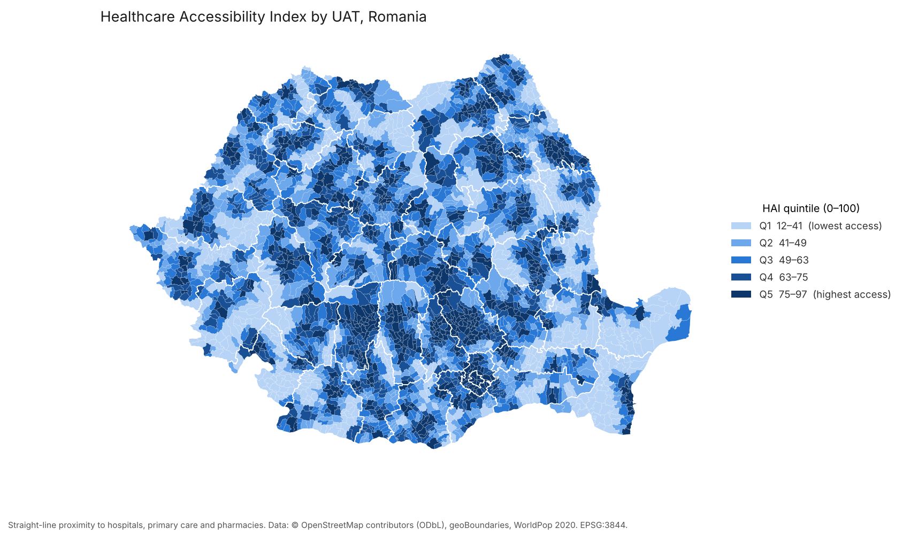

# Healthcare Accessibility Index - Romania

An open-source geospatial data service, end to end: raw open data, validated vector layers, proximity analysis and a composite index, PostGIS, and an **OGC API - Features** service (pygeoapi), containerised with Docker and deployed on Microsoft Azure.

> **Live API:** [hai-api.redwave-6df40bfc.polandcentral.azurecontainerapps.io](https://hai-api.redwave-6df40bfc.polandcentral.azurecontainerapps.io) (first request after a quiet period takes ~20 s while the container starts) | **Download** a whole layer as GeoJSON: `/collections/access_index/items?f=json&limit=5000`


<sub>Regenerate with `python docs/make_map.py` after `hai export`.</sub>

## What it answers
How far is each of Romania's ~3,180 communes and towns (UATs) from hospitals, primary care and pharmacies, and how does that combine into one comparable score?

## Results (OSM extract of 8 Oct 2026)
- **3,187 UATs** and **6,650 facilities** (890 hospitals, 1,992 primary care, 3,768 pharmacies) after cleaning and de-duplication.
- **Best-served counties** (population-weighted HAI): București 86.9, Cluj 79.2, Ilfov 79.1. **Least served**: Tulcea 57.1, Bistrița-Năsăud 57.1, Mehedinți 58.1.
- **Farthest from a hospital**: Dumbrăveni (Constanța) 49.0 km, Ceamurlia de Jos (Tulcea) 46.9 km and Jurilovca (Tulcea) 46.9 km, straight-line.
- **Weights barely matter**: the ranking with the chosen weights and with equal weights has a Spearman correlation of 0.998, because the four indicators are strongly correlated. Percentile-rank scaling would be the next thing to test.

## Method
1. **Data preparation** (`src/hai/prepare.py`). Boundaries are taken from geoBoundaries (ADM1 counties and ADM2 UATs). Invalid geometries are repaired with `shapely.make_valid`, keeping only the polygonal parts, and the number of repairs is logged. Everything is reprojected to **EPSG:3844 (Stereo 70)** so that distances and areas are in metres. Health facilities come from OpenStreetMap via Overpass (`amenity`/`healthcare` = hospital, clinic, doctors, pharmacy). Polygons are reduced to centroids and classified as *hospital / primary / pharmacy*. Duplicates (a node and a building polygon for the same facility within 150 m) are removed, and only facilities inside Romania are kept.
2. **Geoprocessing** (`src/hai/analyse.py`). For each UAT:
   | Indicator | Definition |
   |---|---|
   | `dist_hosp_km` | Distance from the UAT's interior point to the nearest hospital |
   | `dist_primary_km` | Same, for the nearest primary-care facility |
   | `pharm_per_10k` | Pharmacies per 10,000 residents (population summed from WorldPop 100 m) |
   | `share_area_hosp_buffer` | Share of the UAT's area within 10 km of a hospital |

   Each indicator is min-max scaled (distances are inverted, so higher always means better access). The scaled indicators are combined as a weighted mean (0.35 / 0.25 / 0.15 / 0.25) into the **HAI (0-100)**, which is then split into quintiles. The weights are a choice, not a truth: the pipeline reports the Spearman rank correlation against equal weights so you can see how much the ranking depends on them.
3. **Spatial SQL** (`sql/`). This step creates GiST indexes and runs a point-in-polygon aggregation, an `ST_DWithin` count of hospitals within 10 km, and a **KNN nearest hospital** using the `<->` operator. The KNN query cross-checks the GeoPandas result and names each UAT's nearest hospital. It also builds the WGS84 publication tables and a population-weighted county roll-up.
4. **Publication**. pygeoapi serves `access_index` and `county_summary` as OGC API - Features collections (JSON, GeoJSON and HTML, with bbox and property filters). It reads from PostGIS locally and from a GeoPackage built into the image on Azure Container Apps.
5. **Metadata and lineage**. Every step appends its inputs, outputs, parameters and git commit to `metadata/lineage.jsonl`. See [`metadata/lineage.md`](metadata/lineage.md) and [`metadata/dataset.yml`](metadata/dataset.yml).

## Run it
```bash
mamba env create -f environment.yml && conda activate hai
cp .env.example .env              # set a password
docker compose up -d db           # PostGIS 16 / 3.4
hai all                           # download, prepare, analyse, load, export
docker compose up -d api          # http://localhost:5000/collections
pytest
```
Steps can also be run one at a time: `hai download`, `hai prepare`, `hai analyse`, `hai load`, `hai export`.

Example queries:
- `/collections/access_index/items?hai_quintile=1&f=json` returns the least accessible fifth of UATs
- `/collections/access_index/items?bbox=20.9,45.6,21.5,45.9` returns the UATs around Timișoara
- `/collections/county_summary/items?f=json` returns the county roll-up
- `/collections/access_index/items?name=IZVOARELE` or `?county=CLUJ` finds UATs by name or county (exact match, names are stored in capitals)
- `/collections/access_index/items?f=json&crs=http://www.opengis.net/def/crs/EPSG/0/3844` returns Stereo 70 coordinates (EPSG axis order: northing, easting)

## Deploy to Azure
```powershell
az login
hai export                                              # refresh data/processed/publish.gpkg
.\deploy\azure\deploy.ps1 -Location polandcentral     # needs Docker Desktop running
```
The script builds the image locally, pushes it to Azure Container Registry and creates or updates the Container App, which scales to zero when idle. It builds locally because student subscriptions block cloud builds (ACR Tasks). It uses `containerapp create/update` rather than `containerapp up` because the environment is an *express* environment, which does not allow managed identities. Rerun it after any change to the data or `config/pygeoapi.azure.yml`.

## Limitations
- **Straight-line distance, not travel time.** Mountain UATs look better than they are. The next step is OSRM or r5py on the OSM road network.
- **OSM completeness.** Rural family doctors are under-mapped compared with cities, so primary-care distances are biased upwards in rural areas.
- **Origin point.** Each UAT is represented by one interior point. Population-weighted centres from WorldPop would be more realistic.
- **Facility capacity is ignored.** A 20-bed hospital and a county emergency hospital count the same.

## Terms of use
The API and data are provided as-is, for research and demonstration, with no uptime guarantee. The index is a proximity indicator, not a measure of service quality, and must not be used for medical or emergency decisions.

## Data and licences
OpenStreetMap © OpenStreetMap contributors (ODbL 1.0). geoBoundaries (CC BY 4.0). WorldPop (CC BY 4.0). The derived outputs are released under ODbL 1.0.
