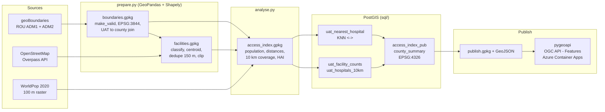

# Data lineage

Every step appends a machine-readable record (inputs, outputs, parameters, git commit, timestamp) to `lineage.jsonl`. This page is the human-readable view.

| Step | Script | Input | Output | Key parameters |
|---|---|---|---|---|
| Download | `download.py` | geoBoundaries API, Overpass, WorldPop | `data/raw/*` | Overpass query stored in the log |
| Prepare boundaries | `prepare.py` | `rou_adm1/2.geojson` | `boundaries.gpkg` | CRS EPSG:3844; repair counts |
| Prepare facilities | `prepare.py` | `osm_health.json` | `facilities.gpkg` | categories, dedupe distance |
| Analyse | `analyse.py` | the two GeoPackages + raster | `access_index.gpkg` | weights, buffer, Spearman check |
| Load + SQL | `load_postgis.py`, `sql/*.sql` | GeoPackages | PostGIS tables | script order |
| Export | `export.py` | PostGIS publication tables | `publish.gpkg`, GeoJSON | |
| Serve | `Dockerfile`, `config/pygeoapi.*.yml` | `publish.gpkg` | OGC API endpoint | |
